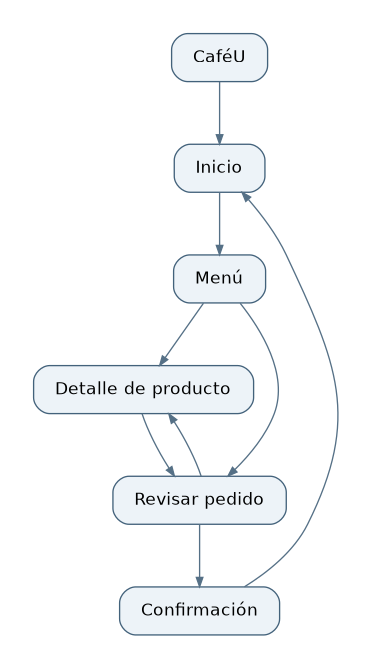
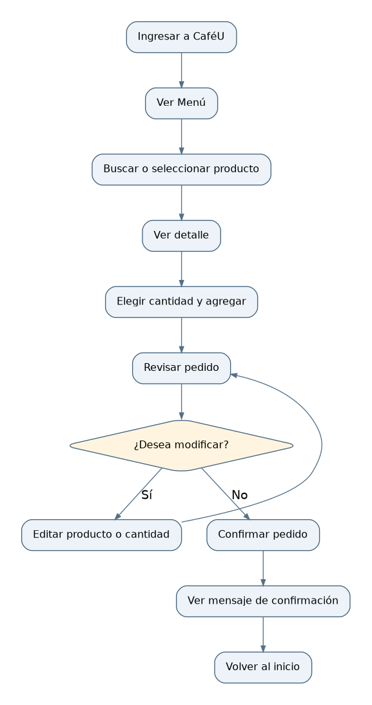
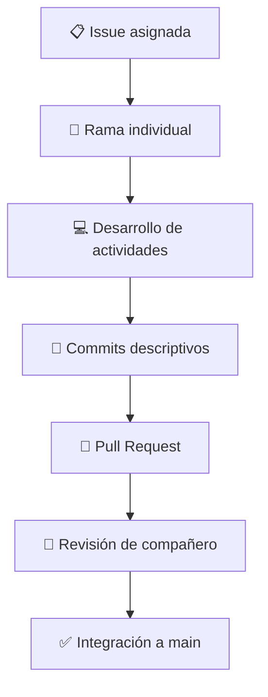

# ☕ CaféU | APE 4 Integral

### 📱 Prototipado, evaluación de usabilidad y mejora de la experiencia de usuario

**Universidad Técnica de Ambato**  
**Facultad de Ingeniería en Sistemas, Electrónica e Industrial (FISEI)**  
**Carrera de Software**  
**Asignatura:** Interacción Humano-Computador (IHC)  
**Nivel:** Quinto "A"  
**Equipo:** Grupo 1

---

## 📌 Descripción del proyecto

**CaféU** es una propuesta de aplicación móvil que permite a los estudiantes universitarios realizar pedidos de productos de cafetería de una manera sencilla y organizada.

Mediante la aplicación, el usuario puede consultar el menú, buscar productos, seleccionar cantidades, revisar su pedido, realizar modificaciones y confirmar la compra.

El proyecto se desarrolla a través de tres etapas:

- 📝 **Fase 1:** identificación de requisitos, organización de la navegación y elaboración de wireframes.
- 🎨 **Fase 2:** refinamiento de pantallas, aplicación de principios de diseño y desarrollo del prototipo en Figma.
- 🧪 **APE 4 Integral:** integración del trabajo anterior, verificación del prototipo, pruebas de usabilidad y documentación de mejoras.

> 💡 **Propósito:** aprovechar los avances de las Fases 1 y 2 para comprobar si los usuarios pueden completar las tareas principales sin dificultades y realizar mejoras cuando sean necesarias.

---

## 🎯 Objetivos

### 🌟 Objetivo general

Integrar y evaluar el diseño de CaféU desarrollado en las Fases 1 y 2 mediante un prototipo navegable, pruebas de usabilidad y mejoras documentadas, con la finalidad de facilitar la búsqueda de productos, modificación y confirmación de pedidos.

### ✅ Objetivos específicos

1. **Integrar** los requisitos, diagramas de navegación, wireframes y decisiones de diseño elaborados en las fases anteriores.
2. **Verificar** la navegación, los estados de interfaz, la retroalimentación y las condiciones de accesibilidad del prototipo.
3. **Evaluar** el funcionamiento de CaféU con usuarios externos para identificar dificultades y documentar las mejoras aplicadas.

---

## 👥 Integrantes del equipo

| 👤 Integrante | 💻 GitHub | 📋 Responsabilidad |
|---|---|---|
| Viviana Maribel Sarco Sailema | [@maribelsailema](https://github.com/maribelsailema) | Integración de fases, diagnóstico y documentación |
| Sebastián Israel Santana Durán | [@Sebaslsd](https://github.com/Sebaslsd) | Prototipo, pantallas y recorridos navegables |
| Wilson Joseph Pillapa Tubón | [@W1LSONN](https://github.com/W1LSONN) | Estados, retroalimentación, heurísticas y accesibilidad |
| Alex Fabricio Guachi Aucapiña | [@A1EXF6A](https://github.com/A1EXF6A) | Pruebas de usabilidad, hallazgos, iteraciones y conclusiones |

---

## 🗂️ Desarrollo del proyecto

### 📝 Fase 1 — Requisitos y wireframes

Durante la primera fase se definieron las necesidades del usuario y la estructura inicial de CaféU.

Se trabajó en los siguientes elementos:

- 👤 Identificación del usuario objetivo.
- 📋 Definición del requisito de usuario.
- 🗺️ Elaboración del sitemap.
- 🔀 Representación de los recorridos mediante user flows.
- 📱 Diseño de cinco wireframes iniciales.

#### 📱 Pantallas desarrolladas

| Pantalla | Función |
|---|---|
| 🏠 Inicio | Presentar CaféU y permitir el acceso al menú |
| 📋 Menú | Consultar, buscar y seleccionar productos |
| ☕ Detalle de producto | Visualizar información, precio y cantidad |
| 🛒 Revisar pedido | Consultar productos, cantidades y total |
| ✅ Confirmación | Informar que el pedido fue recibido |

Los materiales de esta fase se reutilizan como referencia para la navegación y la evaluación integral.

### 🎨 Fase 2 — Refinamiento y prototipo

En esta etapa se trabajó en mejorar la presentación de los wireframes y la experiencia de interacción.

Se consideraron aspectos como:

- 🧩 Agrupación de elementos relacionados.
- 🎯 Jerarquía visual de la información.
- 🔘 Consistencia de botones y controles.
- ♿ Accesibilidad y facilidad de lectura.
- 💬 Retroalimentación de las acciones.
- 🔄 Estados y microinteracciones de la interfaz.

También se desarrolló una propuesta de rediseño en Figma, que constituye la base del prototipo integral.

### 🔗 Prototipo en Figma

**[🎨 Abrir prototipo CaféU](https://www.figma.com/proto/wl3jFYJqHiM852P94kUzlz/cafeU_redise%C3%B1o?node-id=2-636&p=f&t=skNAcfcT0YcAa70l-1&scaling=min-zoom&content-scaling=fixed&page-id=0%3A1&starting-point-node-id=2%3A636)**

> 📌 El prototipo de la Fase 2 se reutiliza. Las pantallas y conexiones adicionales se incorporarán únicamente si son necesarias para cumplir los requisitos de la fase integral.

---

## 🚀 APE 4 Integral — Actividades

La fase integral reúne los entregables anteriores y añade la comprobación del funcionamiento del prototipo, las pruebas de usabilidad y la documentación de mejoras.

### 🔎 1. Diagnóstico de usabilidad

Se revisan los diseños y recorridos existentes para establecer cinco aspectos prioritarios de evaluación.

| N.º | 🔍 Aspecto de revisión | Prioridad preliminar |
|---|---|---|
| 1 | Facilidad para localizar productos en el menú | 🔴 Alta |
| 2 | Claridad de la acción Agregar al pedido | 🟡 Media |
| 3 | Facilidad para modificar cantidades | 🔴 Alta |
| 4 | Claridad de mensajes de procesamiento y error | 🔴 Alta |
| 5 | Comprensión de la confirmación final | 🔴 Alta |

> ⚠️ Estos puntos son riesgos iniciales de usabilidad que deben comprobarse. No representan errores observados en pruebas reales.

📄 **[Consultar diagnóstico completo](diagnostico.md)**

### 🧭 2. Sitemap y recorridos

Se reutilizan los diagramas de navegación de la Fase 1 y se actualizan solamente cuando sea necesario.

**🗺️ Sitemap**



**🔀 User flow**



Los diagramas representan la estructura y los recorridos esperados de la aplicación.

### 📱 3. Prototipo navegable

El prototipo integral deberá permitir ejecutar tres recorridos y contar con al menos seis pantallas funcionales.

| Flujo | Acción principal | Resultado esperado |
|---|---|---|
| 🔍 Flujo 1 | Buscar y seleccionar un producto | Producto agregado al pedido |
| ✏️ Flujo 2 | Modificar el pedido | Cantidades y total actualizados |
| ✅ Flujo 3 | Confirmar el pedido | Mensaje de confirmación visible |

📂 **[Documentación del prototipo](prototipo/)**

### 🔔 4. Estados y retroalimentación

Se comprobarán los estados de interfaz considerados en el rediseño.

| Estado | Descripción |
|---|---|
| ⚪ Normal | La pantalla está disponible para interactuar |
| ⏳ Procesamiento | El sistema informa que está realizando una acción |
| ❌ Error | Se comunica un problema y cómo continuar |
| ✅ Éxito | Se confirma que la acción se completó |

También se verificará al menos una microinteracción funcional.

### ♿ 5. Heurísticas y accesibilidad

La revisión de usabilidad considerará tres heurísticas de Nielsen:

- 👁️ Visibilidad del estado del sistema.
- 🛡️ Prevención de errores.
- 🔙 Control y libertad del usuario.

Se comprobarán dos condiciones de accesibilidad:

- 🔤 Contraste y legibilidad de textos.
- 👆 Tamaño e identificación de los controles.

📄 **[Evaluación de accesibilidad](prototipo/evaluacion-accesibilidad.md)**

### 🧪 6. Pruebas con usuarios

Se realizará una evaluación con dos personas ajenas al equipo de diseño. Cada participante deberá realizar tres tareas.

| Tarea | Actividad | Resultado esperado |
|---|---|---|
| 🥇 T1 | Buscar y seleccionar un producto | Producto incorporado al pedido |
| 🥈 T2 | Modificar un pedido | Modificación reflejada correctamente |
| 🥉 T3 | Confirmar un pedido | Confirmación visible |

Durante las pruebas se registrarán:

- ⏱️ Tiempo de ejecución.
- 🎯 Cumplimiento de la tarea.
- ⚠️ Errores encontrados.
- 💬 Comentarios y dificultades observadas.

**Documentación de pruebas:**

- 📋 [Protocolo](pruebas/protocolo.md)
- 📊 [Resultados CSV](pruebas/resultados.csv)
- 🔎 [Hallazgos](pruebas/hallazgos.md)

> 🕒 Los resultados se incorporarán después de ejecutar las pruebas. No se utilizarán datos simulados como evidencia de evaluación.

### 🔄 7. Iteración y mejoras

A partir de los hallazgos obtenidos se deberán aplicar y verificar al menos tres correcciones en el prototipo.

Cada modificación deberá incluir el problema identificado, la solución aplicada, la justificación y las evidencias de antes y después.

**Documentación de iteración:**

- 🖼️ [Comparación antes y después](iteracion/antes-despues.md)
- 🛠️ [Registro de cambios](iteracion/cambios.md)

---

## 📁 Estructura del proyecto

```text
📦 APE4-integral/
│
├── 📄 README.md
├── 📄 diagnostico.md
├── 🗺️ sitemap.png
├── 🔀 user-flow.png
│
├── 📂 wireframes/
│   ├── 📂 originales/
│   └── 📂 refinados/
│
├── 📂 prototipo/
│   ├── 📄 enlace_figma.md
│   ├── 📄 recorridos.md
│   ├── 📄 estados-feedback.md
│   └── 📄 evaluacion-accesibilidad.md
│
├── 📂 pruebas/
│   ├── 📄 protocolo.md
│   ├── 📊 resultados.csv
│   └── 📄 hallazgos.md
│
├── 📂 iteracion/
│   ├── 📄 antes-despues.md
│   └── 📄 cambios.md
│
├── 📂 evidencias/
│   ├── 📂 pantallas/
│   ├── 📂 flujos/
│   ├── 📂 estados/
│   ├── 📂 microinteracciones/
│   ├── 📂 accesibilidad/
│   ├── 📂 pruebas/
│   └── 📂 correcciones/
│
├── 📄 conclusiones.md
└── 📕 informe_final.pdf
```

> 📌 La carpeta `APE4-integral/` se agrega al repositorio sin eliminar las entregas de las Fases 1 y 2.

---

## 🌿 Organización del trabajo en GitHub

Cada integrante tendrá una Issue, una rama propia y commits descriptivos.

| 👤 Integrante | 🌿 Rama | 🔍 Revisor |
|---|---|---|
| Viviana | `feature/integracion-diagnostico` | Sebastián |
| Sebastián | `feature/prototipo-integral` | Viviana |
| Wilson | `feature/heuristicas-accesibilidad` | Alex |
| Alex | `feature/pruebas-iteracion` | Wilson |

### 🔁 Flujo de colaboración



En caso de que los permisos impidan crear Pull Requests, se conservará el historial individual de commits y se documentará el impedimento.

---

## 📸 Evidencias del proyecto

Las evidencias se organizarán dentro de la carpeta [`evidencias/`](evidencias/) e incluirán los materiales necesarios para comprobar el desarrollo del proyecto.

Se incorporarán capturas del prototipo, recorridos, estados, verificaciones de accesibilidad, sesiones de prueba y correcciones realizadas.

Cada evidencia deberá corresponder a una actividad efectivamente ejecutada.

---

## 📊 Entregables de la fase integral

| 📄 Entregable | 📍 Ubicación |
|---|---|
| Documentación general | `README.md` |
| Diagnóstico UX | `diagnostico.md` |
| Sitemap | `sitemap.png` |
| User flow | `user-flow.png` |
| Wireframes | `wireframes/` |
| Prototipo navegable | `prototipo/` |
| Protocolo de pruebas | `pruebas/protocolo.md` |
| Resultados | `pruebas/resultados.csv` |
| Hallazgos | `pruebas/hallazgos.md` |
| Comparación de mejoras | `iteracion/antes-despues.md` |
| Evidencias | `evidencias/` |
| Conclusiones | `conclusiones.md` |

---

## 🎓 Presentación y defensa

La entrega final incluirá el enlace al repositorio, el acceso a esta carpeta, el prototipo navegable y el informe PDF con las evidencias.

Durante la defensa se presentará:

1. 📱 Una demostración completa de una tarea.
2. 🔎 Un problema identificado durante las pruebas.
3. 🛠️ La corrección aplicada y su justificación.
4. 👥 La contribución individual de cada integrante.

---

## 🏁 Conclusiones

Las conclusiones finales se elaborarán una vez que se hayan realizado las pruebas y comprobado las mejoras.

Se analizarán la facilidad de navegación, la claridad de los estados y mensajes, las condiciones de accesibilidad y los cambios realizados a partir de los resultados.

📄 **[Consultar conclusiones](conclusiones.md)**

---

## 🔗 Enlaces importantes

- 🐙 **[Repositorio del equipo](https://github.com/maribelsailema/HCI_2026_G1)**
- 🎨 **[Prototipo de CaféU en Figma](https://www.figma.com/proto/wl3jFYJqHiM852P94kUzlz/cafeU_redise%C3%B1o?node-id=2-636&p=f&t=skNAcfcT0YcAa70l-1&scaling=min-zoom&content-scaling=fixed&page-id=0%3A1&starting-point-node-id=2%3A636)**
- 📂 **[Documentación integral](./)**
- 📋 **[Diagnóstico de usabilidad](diagnostico.md)**

