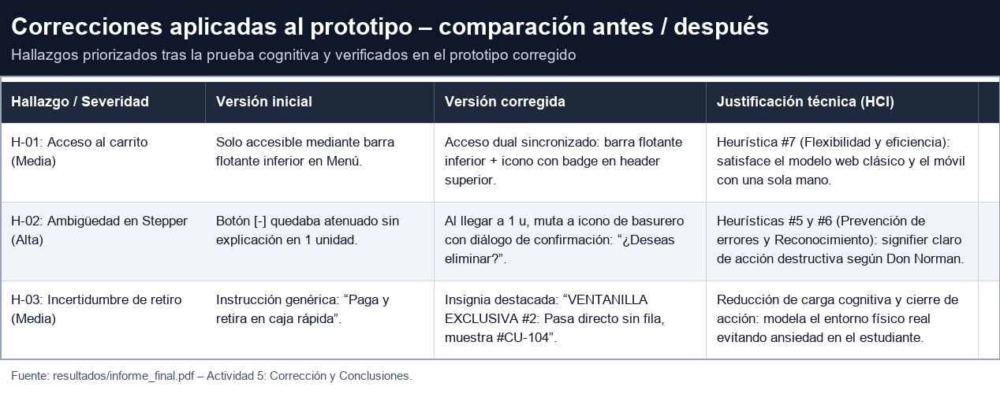
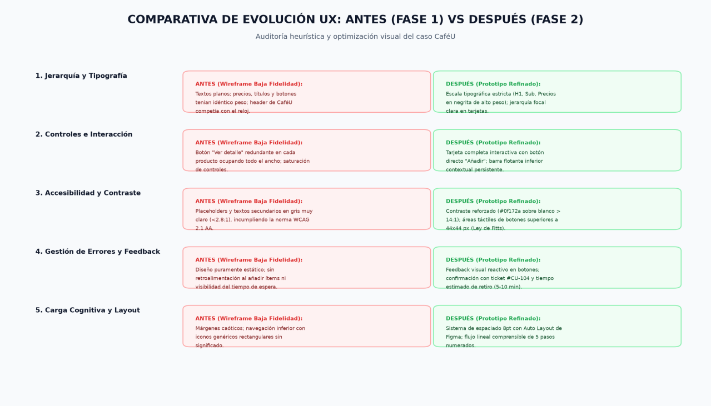

# Comparación Antes / Después — CaféU (APE 4 Integral)

> Comparación visual y justificada entre la versión inicial del prototipo y la versión corregida, correspondiente a las tres correcciones registradas en [`cambios.md`](cambios.md).

---

## 1. Comparación por corrección

### C-01 · Acceso al carrito (HI-02 · Severidad Media)

| | Versión inicial | Versión corregida |
| :--- | :--- | :--- |
| **Acceso al pedido** | Sólo mediante la barra flotante inferior en el menú | **Acceso dual sincronizado:** barra flotante inferior + icono con badge de contador en el header superior |
| **Comportamiento observado** | Mateo buscó el carrito en la esquina superior derecha antes de notar la barra inferior (T1, 6 s, 1 duda) | Ambas rutas llevan a revisar pedido; el contador se mantiene sincronizado |
| **Justificación HCI** | — | Heurística **#7 (Flexibilidad y eficiencia de uso):** satisface el modelo web clásico y el uso móvil con una sola mano |
| **Problema que resuelve** | Retraso y fricción en el paso crítico del pedido | Localización inmediata del carrito sin búsqueda |

### C-02 · Eliminación de ítems (HI-01 · Severidad Alta)

| | Versión inicial | Versión corregida |
| :--- | :--- | :--- |
| **Control `[-]` con 1 unidad** | Botón `[-]` atenuado sin explicación; ambigüedad sobre si borraba el ítem | Al llegar a 1 u, `[-]` **muta a icono de basurero** + diálogo **"¿Deseas eliminar?"** con botón seguro de retorno |
| **Comportamiento observado** | Mateo dudó si `[-]` borraría el ítem de golpe; la duda detuvo su acción (T2, 7 s, 1 duda) | Acción destructiva reconocible y confirmada antes de ejecutarse |
| **Justificación HCI** | — | Heurísticas **#5 (Prevención de errores)** y **#6 (Reconocimiento en vez de recuerdo);** *signifier* claro de acción destructiva (Norman) |
| **Problema que resuelve** | Temor a perder productos y desconfianza en el carrito | Protección explícita de datos y control percibido del usuario |

### C-03 · Retiro del pedido (H-03 · Severidad Media)

| | Versión inicial | Versión corregida |
| :--- | :--- | :--- |
| **Instrucción de retiro** | Genérica: *"Paga y retira en caja rápida"* sin ubicación precisa | Insignia destacada: **"VENTANILLA EXCLUSIVA #2: Pasa directo sin fila, muestra #CU-104"** |
| **Comportamiento observado** | Incertidumbre sobre dónde retirar; ansiedad al confirmar | La confirmación cierra el ciclo con el entorno físico de la cafetería |
| **Justificación HCI** | — | Reducción de **carga cognitiva** y acoplamiento digital–físico (Norman): la interfaz modela el punto de retiro real |
| **Problema que resuelve** | Duda sobre el siguiente paso tras confirmar | Cierre cognitivo total del flujo de compra |

**Evidencia visual de las tres correcciones:**

**Capturas de la versión corregida:**

* [`04_Revisar_Pedido.png`](../evidencias/correcciones/04_Revisar_Pedido.png) — revisión y edición del pedido con controles explícitos.
* [`05_Confirmacion.png`](../evidencias/correcciones/05_Confirmacion.png) — confirmación con ticket #CU-104 e indicación de ventanilla exclusiva #2.

---

## 2. Evolución general de la experiencia de usuario

| Dimensión | Antes (wireframe / prototipo inicial) | Después (prototipo corregido) |
| :--- | :--- | :--- |
| Jerarquía tipográfica | Textos planos y pesos idénticos | Escala tipográfica H1/Sub y precios en negrita |
| Controles e interacción | Botón "Ver detalle" redundante | Tarjeta interactiva + botón directo "Añadir" |
| Accesibilidad | Contraste gris muy claro (< 2,8:1) | Contraste > 14:1 y áreas táctiles ≥ 44×44 px |
| Gestión de errores y feedback | Diseño estático, sin retroalimentación | Estados visibles, ticket #CU-104 y modal de cancelación |
| Carga cognitiva y layout | Márgenes caóticos e íconos genéricos | Espaciado 8 pt con Auto Layout y flujo de pasos |
| Acceso al carrito (HI-02) | Sólo barra flotante inferior | Acceso dual sincronizado (C-01) |
| Eliminación de ítems (HI-01) | `[-]` atenuado y ambiguo | Basurero + confirmación explícita (C-02) |
| Retiro del pedido (H-03) | Instrucción genérica | Insignia de ventanilla exclusiva #2 (C-03) |

---

## 3. Problemas resueltos por cada modificación

| Modificación | Problema que resuelve | Origen del problema | Verificación |
| :--- | :--- | :--- | :--- |
| **C-01** — Acceso dual al carrito | El usuario no encontraba dónde ver su pedido | Hallazgo HI-02, evidenciado por Mateo Morales en T1 | Rutas y contador sincronizados |
| **C-02** — Basurero + confirmación | Ambigüedad destructiva del `[-]` con 1 unidad | Hallazgo HI-01, evidenciado por Mateo Morales en T2 | Mutación del control y diálogo comprobados |
| **C-03** — Insignia de ventanilla | Incertidumbre sobre dónde retirar el pedido | Observación transversal de la sesión (H-03) | Ubicación visible junto a #CU-104 |

---

## 4. Resultado de la comparación

| Prioridad | Acción | Estado |
| :---: | :--- | :--- |
| 1 | Corregir HI-01 (stepper) — C-02 | Aplicada y verificada |
| 2 | Corregir HI-02 (acceso dual al carrito) — C-01 | Aplicada y verificada |
| 3 | Corregir H-03 (insignia de retiro) — C-03 | Aplicada y verificada |
| 4 | HI-04 pago QR | Backlog de producto (fuera de alcance) |
| 5 | HI-03 contraste de "+ Seguir comprando" | Backlog de accesibilidad, refuerzo colateral con C-01 |

> **Tres correcciones justificadas por hallazgos reales, implementadas por los responsables correspondientes y verificadas con evidencia visual antes/después.**

---

**☕ CaféU — Comparación antes/después · APE 4 Integral**
