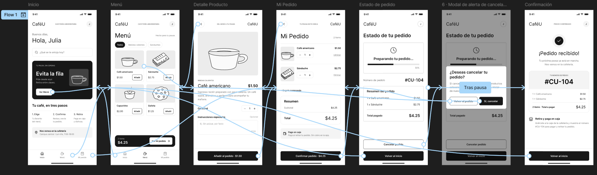

# Documentación de Recorridos de Usuario - CaféU

Este documento detalla los tres recorridos principales implementados y verificados en el prototipo interactivo de Figma para la **APE 4 Integral**, garantizando una experiencia de usuario fluida y segura.

---

## Recorrido 1: Buscar y seleccionar un producto
* **Objetivo:** Permitir que el estudiante explore el menú y añada productos a su carrito de compras.
* **Flujo paso a paso:**
  1. El usuario inicia en la pantalla **Inicio** y presiona el botón para ver la carta.
  2. El sistema redirige a la pantalla **Menú**, donde el usuario visualiza los productos disponibles (por ejemplo, Café americano y Sánduche).
  3. Al hacer clic en un producto, se abre la pantalla **Detalle del Producto**, donde se ajusta la cantidad deseada.
  4. Finalmente, se pulsa *"Agregar al pedido"* para actualizar la orden y avanzar al resumen.

---

## Recorrido 2: Modificar cantidades o editar el pedido
* **Objetivo:** Brindar flexibilidad al usuario para revisar los ítems seleccionados antes de pagar.
* **Flujo paso a paso:**
  1. Desde la pantalla **Mi Pedido**, el usuario visualiza el desglose actual (1 x Café americano $1,50 y 1 x Sánduche $2,75, con un total de $4,25).
  2. Si desea ajustar cantidades, interactúa con los controles o decide regresar al menú para añadir más elementos.
  3. En caso de arrepentirse o querer descartar la orden, el sistema incluye una capa de seguridad: al intentar cancelar, se activa el **Modal de Alerta de Cancelación** (*"¿Deseas cancelar tu pedido?"*), requiriendo una confirmación explícita para evitar errores de interacción.

---

## Recorrido 3: Confirmar el pedido y visualizar el resultado
* **Objetivo:** Completar exitosamente la transacción y proporcionar credenciales claras para el retiro en cafetería.
* **Flujo paso a paso:**
  1. Estando en la pantalla **Mi Pedido**, el usuario verifica los datos y presiona el botón principal *"Confirmar pedido"*.
  2. El sistema procesa la solicitud y muestra la pantalla de **Confirmación** (*"¡Pedido recibido!"*).
  3. Se genera un número de pedido único (`#CU-104`), un resumen total ($4,25) y las instrucciones claras para retirar el producto directamente en la barra de la cafetería.

