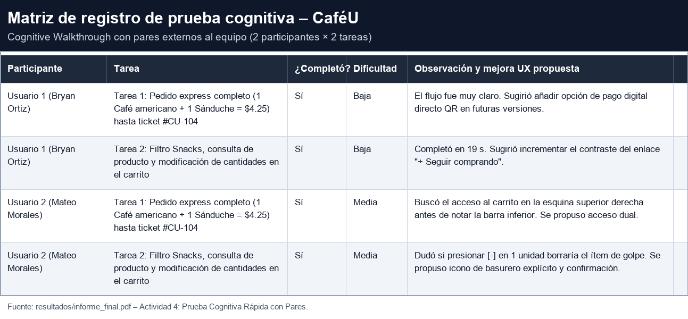

# Prueba Cognitiva con Usuarios Externos - CaféU

> Este documento describe la **Actividad 4: Prueba Cognitiva Rápida con Pares** ejecutada sobre el prototipo navegable de CaféU.
> Registra las tareas representativas, los participantes externos al equipo, el guion de sesión y el resultado observado sin indicar a los participantes dónde hacer clic.

---

## 1. Objetivo de la evaluación

Evaluar el prototipo interactivo de CaféU con participantes ajenos al equipo de diseño para identificar dificultades de comprensión, dudas y errores en la ejecución de tareas representativas, con el fin de alimentar la priorización de correcciones de la Fase 2.

**Alcance:** dos tareas realizadas por dos participantes externos al equipo (cuatro registros en total).

**Método:** *Cognitive Walkthrough* rápido con técnica de *piensa en voz alta*.

**Restricción metodológica:** el moderador **no indicó en ningún momento dónde hacer clic**; sólo enunció el objetivo de cada tarea. Las dudas, pausas y errores se registraron en el momento, sin corregir al participante.

---

## 2. Participantes externos al equipo

| Participante | Rol en la prueba | Vínculo | Tareas realizadas |
| :--- | :--- | :--- | :--- |
| **Usuario 1 — Bryan Ortiz** | Estudiante universitario, par del equipo | Externo al equipo de trabajo | Tarea 1 y Tarea 2 |
| **Usuario 2 — Mateo Morales** | Estudiante universitario, par del equipo | Externo al equipo de trabajo | Tarea 1 y Tarea 2 |

> Ambos participantes son pares universitarios ajenos a las decisiones de diseño, condición requerida por los criterios de aceptación de la Fase 2.

---

## 3. Tareas representativas de CaféU

### Tarea 1 — Pedido express completo (Happy Path)

* **Objetivo enunciado al participante:** "Realiza un pedido con **1 Café americano y 1 Sánduche** (total **$4.25**) y obtén la confirmación de tu pedido."
* **Criterio de éxito:** llegar a la pantalla de confirmación con el ticket **#CU-104**.
* **Alcance funcional:** consultar menú → seleccionar producto → personalizar cantidad → añadir al pedido → revisar el carrito → confirmar → recibir retroalimentación de éxito.
* **Recorrido cubierto:** Recorrido 1 (flujo principal) / Recorrido A del prototipo.

### Tarea 2 — Filtro, consulta y edición del pedido

* **Objetivo enunciado al participante:** "Busca productos de tipo **Snacks**, consulta uno de ellos y **modifica las cantidades** de tu pedido en el carrito."
* **Criterio de éxito:** aplicar el filtro, abrir un producto y cambiar cantidades con el selector `[-] / [+]`, conservando el pedido coherente.
* **Alcance funcional:** chips de filtro → detalle de producto → carrito → stepper de cantidades → retorno al catálogo.
* **Recorrido cubierto:** Recorrido 2 (flujo secundario de gestión y filtros) / Recorrido B del prototipo.

---

## 4. Guion de sesión (sin indicaciones de ubicación de clics)

1. **Bienvenida:** presentación del prototipo como "una app de pedidos para la cafetería universitaria" y del objetivo de la sesión: *evaluar la aplicación, no al usuario*.
2. **Enunciado de tarea:** se entrega sólo el objetivo enunciado en la sección 3; **no se señala ninguna pantalla, botón ni recorrido**.
3. **Pensamiento en voz alta:** se solicita al participante que diga en voz alta qué busca, qué espera que suceda y qué entiende de cada mensaje.
4. **Observación en silencio:** el moderador no resuelve dudas de ubicación; registra tiempo, pausas, rutas alternativas y expresiones de confusión.
5. **Cierre breve:** se pregunta qué generó duda y qué mejoraría; estas respuestas alimentan la matriz de hallazgos.

---

## 5. Registro de resultados por participante y tarea

### 5.1 Usuario 1 — Bryan Ortiz

| Tarea | ¿Completó? | Tiempo | Dudas / dificultades | Errores |
| :--- | :---: | :---: | :--- | :---: |
| **Tarea 1** — Pedido express completo | **Sí** | Normal | Dificultad **baja**: el flujo fue percibido como "muy claro". | Ninguno |
| **Tarea 2** — Filtro Snacks y edición de cantidades | **Sí** | **19 s** | Dificultad **baja**: sin bloqueos para aplicar el filtro ni editar cantidades. | Ninguno |

**Observaciones del participante:**
* Sugirió añadir **pago digital directo por QR** en futuras versiones (fuera del alcance actual del prototipo).
* Sugirió **incrementar el contraste** del enlace **"+ Seguir comprando"** en la pantalla de revisar pedido.

### 5.2 Usuario 2 — Mateo Morales

| Tarea | ¿Completó? | Tiempo | Dudas / dificultades | Errores |
| :--- | :---: | :---: | :--- | :---: |
| **Tarea 1** — Pedido express completo | **Sí** | Normal | Dificultad **media**: buscó el acceso al carrito en la **esquina superior derecha** antes de notar la barra flotante inferior. | Ninguno (búsqueda fallida inicial, se recuperó solo) |
| **Tarea 2** — Filtro Snacks y edición de cantidades | **Sí** | Normal | Dificultad **media**: dudó si presionar **`[-]`** con 1 unidad **borraría el ítem de golpe**. | Ninguno (duda de acción destructiva) |

**Observaciones del participante:**
* Esperaba un **icono de carrito con contador** en el encabezado, por convención aprendida en otras aplicaciones.
* Solicitó una acción de **eliminación explícita (basurero)** con confirmación, en lugar de un botón `[-]` ambiguo.

### 5.3 Resumen agregado

| Indicador | Resultado |
| :--- | :--- |
| Participantes externos al equipo | **2** (Bryan Ortiz, Mateo Morales) |
| Tareas por participante | **2** |
| Registros totales | **4** |
| Tareas completadas | **4 / 4 (100 %)** |
| Errores que impidieron completar la tarea | **0** |
| Dudas registradas | **2** (ambas del Usuario 2) |
| Dificultad reportada | Baja (Usuario 1) / Media (Usuario 2) |
| Sugerencias adicionales | Pago QR, contraste del enlace "+ Seguir comprando" |

---

## 6. Matriz de pruebas

| Participante | Tarea | ¿Completó? | Dificultad | Mejora UX propuesta |
| :--- | :--- | :---: | :---: | :--- |
| Usuario 1 (Bryan Ortiz) | Tarea 1 (Pedido express completo) | Sí | Baja | El flujo fue muy claro. Sugirió añadir opción de pago digital directo QR en futuras versiones. |
| Usuario 1 (Bryan Ortiz) | Tarea 2 (Filtro Snacks y edición) | Sí | Baja | Completó en 19 s. Sugirió incrementar el contraste del enlace "+ Seguir comprando". |
| Usuario 2 (Mateo Morales) | Tarea 1 (Pedido express completo) | Sí | Media | Buscó el acceso al carrito en la esquina superior derecha antes de notar la barra inferior. Se propuso acceso dual. |
| Usuario 2 (Mateo Morales) | Tarea 2 (Filtro Snacks y edición) | Sí | Media | Dudó si presionar [-] en 1 unidad borraría el ítem de golpe. Se propuso icono de basurero explícito y confirmación. |

---

## 7. Evidencias de la prueba

| Evidencia | Archivo |
| :--- | :--- |
| Matriz de registro renderizada | [`evidencias/pruebas/matriz_registro_pruebas.png`](../evidencias/pruebas/matriz_registro_pruebas.png) |
| Registro narrativo de las sesiones | [`evidencias/pruebas/registro_pruebas.md`](../evidencias/pruebas/registro_pruebas.md) |
| Pantalla de inicio observada | [`evidencias/pruebas/01_Inicio.png`](../evidencias/pruebas/01_Inicio.png) |
| Pantalla de menú con chips de filtro | [`evidencias/pruebas/02_Menu.png`](../evidencias/pruebas/02_Menu.png) |
| Pantalla de detalle de producto | [`evidencias/pruebas/03_Detalle_Producto.png`](../evidencias/pruebas/03_Detalle_Producto.png) |
| Pantalla de revisar pedido (edición) | [`evidencias/pruebas/04_Revisar_Pedido.png`](../evidencias/pruebas/04_Revisar_Pedido.png) |
| Pantalla de confirmación (ticket #CU-104) | [`evidencias/pruebas/05_Confirmacion.png`](../evidencias/pruebas/05_Confirmacion.png) |

---

## 8. Hallazgos extraídos de la prueba

Los hallazgos se priorizaron y documentaron en [`matriz_mejoras.md`](matriz_mejoras.md):

1. **H-01 (Media):** el acceso al carrito no coincide con el modelo mental del usuario (header superior).
2. **H-02 (Alta):** ambigüedad del selector `[-]` con 1 unidad (¿borra el ítem?).
3. **H-03 (Media):** incertidumbre sobre dónde retirar y pagar el pedido.
4. **S-01 / S-02 (Baja):** sugerencias de backlog (pago QR y contraste del enlace "+ Seguir comprando").

---

