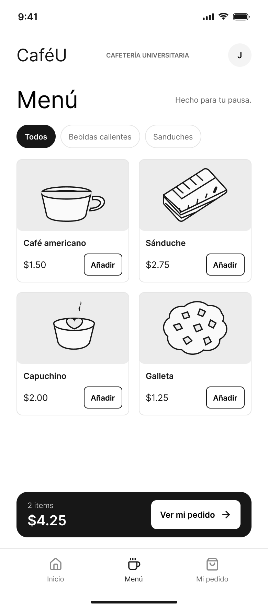
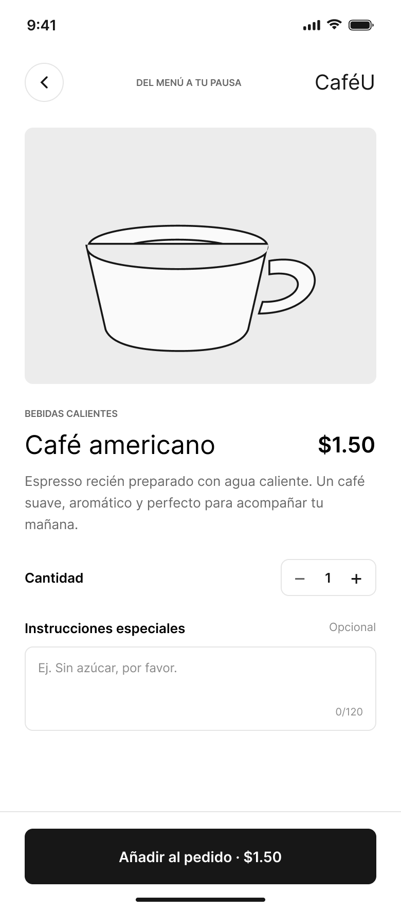
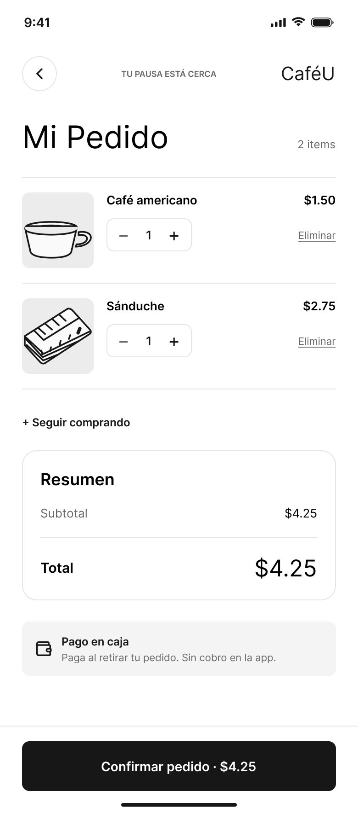
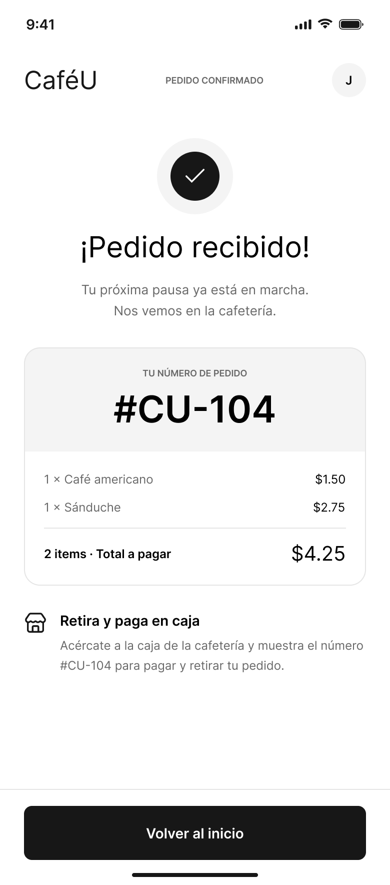
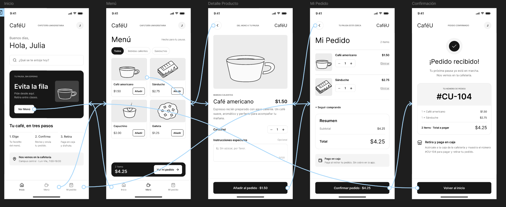

# Documentación de Recorridos del Prototipo - CaféU
> Este documento describe la estructura de navegación, la arquitectura de interacciones y los recorridos de usuario implementados en el prototipo interactivo de **CaféU**.

---

## 1. Pantallas Incorporadas

Se implementaron y refinaron **5 pantallas principales** con Auto Layout y componentes reutilizables:

1. **`01_Inicio`:** Pantalla principal de bienvenida con banner promocional y botón de acceso directo al menú.

2. **`02_Menu`:** Catálogo de productos organizado con filtros por categoría, tarjetas de producto con botón de acción rápida y barra flotante de resumen de carrito.

3. **`03_Detalle_Producto`:** Vista detallada del producto con selector de cantidad, notas especiales para la preparación y botón de adición.

4. **`04_Revisar_Pedido`:** Pantalla de carrito con lista de productos, controles de edición de cantidad, opción de eliminación, desglose de costos y confirmación.

5. **`05_Confirmacion`:** Pantalla final de éxito con el número de pedido (`#CU-104`), instrucciones de cobro/retiro en caja y retorno al inicio.

---

## 2. Recorridos de Usuario Implementados

### Recorrido A: Selección y Confirmación del Pedido (Flujo Principal)
* **Objetivo:** Completar una orden desde la pantalla inicial hasta la emisión del ticket de pedido.
* **Pasos:**
  1. En `01_Inicio`, el usuario presiona **"Ver Menú"** → Navega a `02_Menu`.
  2. En `02_Menu`, el usuario selecciona la tarjeta del **"Café americano"** → Navega a `03_Detalle_Producto`.
  3. En `03_Detalle_Producto`, ajusta la cantidad y presiona **"Añadir al pedido · $1.50"** → Retorna a `02_Menu`.
  4. En `02_Menu`, hace clic en la barra flotante **"Ver mi pedido"** → Navega a `04_Revisar_Pedido`.
  5. En `04_Revisar_Pedido`, revisa el total ($4.25) y presiona **"Confirmar pedido · $4.25"** → Navega a `05_Confirmacion`.
  6. En `05_Confirmacion`, consulta su número `#CU-104` y presiona **"Volver al inicio"** → Regresa a `01_Inicio`.

### Recorrido B: Edición de Pedido y Confirmación Posterior
* **Objetivo:** Modificar los artículos del carrito antes de finalizar la compra.
* **Pasos:**
  1. Desde `04_Revisar_Pedido`, el usuario hace clic en **"+ Seguir comprando"** o en el botón de regreso (`<`) → Navega de vuelta a `02_Menu`.
  2. En `02_Menu`, el usuario puede agregar nuevos productos mediante el botón **"Añadir"** de las tarjetas.
  3. Retorna a `04_Revisar_Pedido` presionando **"Ver mi pedido"**.
  4. En `04_Revisar_Pedido`, utiliza los controles `- / +` para modificar cantidades o hace clic en **"Eliminar"** para descartar un ítem.
  5. Una vez ajustado el pedido, presiona **"Confirmar pedido"** → Navega a `05_Confirmacion`.

---

## 3. Matriz de Navegación y Botones

| Pantalla | Elemento | Evento / Acción | Destino |
| :--- | :--- | :--- | :--- |
| `01_Inicio` | Botón "Ver Menú" | Al Hacer clic | `02_Menu` |
| `02_Menu` | Card "Café americano" | Al Hacer clic | `03_Detalle_Producto` |
| `02_Menu` | Botón "Ver mi pedido" | Al Hacer clic | `04_Revisar_Pedido` |
| `03_Detalle_Producto` | Botón "Añadir al pedido" | Al Hacer clic | `02_Menu` |
| `03_Detalle_Producto` | Botón Regreso (`<`) | Al Hacer clic | `02_Menu` |
| `04_Revisar_Pedido` | Enlace "+ Seguir comprando" | Al Hacer clic | `02_Menu` |
| `04_Revisar_Pedido` | Botón "Confirmar pedido" | Al Hacer clic | `05_Confirmacion` |
| `05_Confirmacion` | Botón "Volver al inicio" | Al Hacer clic | `01_Inicio` |

---

## 4. Coordinación y Pruebas
* **Microinteracciones y Estados:** Coordinado con Wilson para la unificación de estados (*hover*, *pressed*, variables de color y feedback tipográfico).
* **Evaluación con Usuarios:** Enlace preparado e independizado para la realización de pruebas de usabilidad guiadas por Alex.
